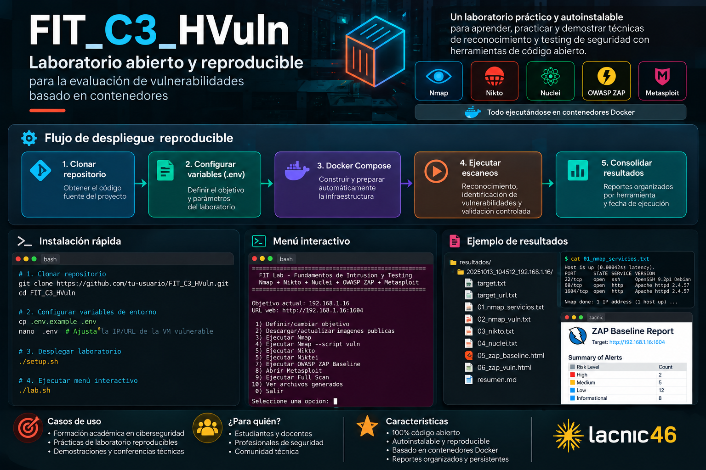

# 🛡️ Laboratorio para prueba de herramientas de identificación y análisis de vulnerabilidades


> **Nota sobre Build:** esta etiqueta requiere que exista el workflow `.github/workflows/main.yml` en GitHub. Si todavía no está configurado, mostrará un estado no disponible; no constituye una prueba de integración continua.



**Nmap · Nikto · Nuclei · OWASP ZAP · Metasploit**  
**Docker Compose · Menú interactivo · Reportes de análisis**

---

## 🎯 Descripción

**FIT_C3_HVuln** es un laboratorio abierto y reproducible para practicar **reconocimiento, identificación, análisis y validación controlada de vulnerabilidades** sobre una máquina virtual vulnerable, distribuida por el docente en formato OVA.

El laboratorio automatiza la preparación de herramientas en contenedores Docker y ofrece un menú interactivo para ejecutar escaneos y revisar sus resultados. Está pensado para actividades académicas, demostraciones técnicas y formación en seguridad ofensiva responsable.

> ⚠️ **Uso autorizado:** ejecute las pruebas únicamente contra la VM vulnerable del curso o contra sistemas para los cuales tenga autorización explícita. Algunas verificaciones generan tráfico intrusivo.

## 🧰 Herramientas incluidas

| Herramienta | Uso principal |
|---|---|
| **Nmap** | Descubrimiento de puertos y servicios; scripts NSE, incluido `--script vuln` |
| **Nikto** | Revisión de configuraciones y hallazgos comunes en servicios web |
| **Nuclei** | Verificaciones basadas en plantillas |
| **OWASP ZAP** | Análisis automatizado de aplicaciones web mediante Baseline Scan |
| **Metasploit Framework** | Investigación y validación manual de hallazgos, dentro del alcance autorizado |

## 🔄 Flujo de despliegue reproducible

1. **Clonar el repositorio** y acceder al directorio del proyecto.
2. **Configurar variables (`.env`)** con la dirección IP y la URL del objetivo autorizado.
3. **Ejecutar `setup.sh`** para preparar las imágenes y construir el contenedor local de Metasploit mediante Docker Compose.
4. **Ejecutar escaneos** desde el menú de `lab.sh`.
5. **Consolidar resultados** y documentar evidencias y conclusiones.

## 📋 Requisitos previos

- Equipo Linux con Docker Engine y el complemento Docker Compose (`docker compose`).
- Acceso a Internet durante la descarga inicial de imágenes y la construcción de Metasploit.
- Git y Bash.
- Una VM vulnerable OVA previamente importada, encendida y accesible desde el equipo que ejecuta Docker.
- Recursos de memoria, CPU y disco suficientes para ejecutar los contenedores; el espacio requerido depende de las imágenes y sus actualizaciones.

Verifique los requisitos:

```bash
git --version
docker --version
docker compose version
docker info
```

Si su usuario no tiene acceso al daemon de Docker, deberá configurar los permisos correspondientes antes de ejecutar el instalador.

## 🚀 Instalación rápida

```bash
git clone https://github.com/danfelun/FIT_C3_HVuln.git
cd FIT_C3_HVuln

# Crear la configuración local a partir de la plantilla
cp .env.example .env
nano .env

# Validar y desplegar
chmod +x setup.sh lab.sh
docker compose config --quiet
./setup.sh

# Abrir el menú
./lab.sh
```

En `.env`, ajuste los valores de la plantilla al objetivo de su práctica. Por ejemplo, la IP puede ser `192.168.1.16` y la URL `http://192.168.1.16:1604`. **Conserve los nombres de variables definidos en `.env.example`; no reemplace la plantilla por nombres distintos.**

El archivo `.env` contiene la configuración local y **no debe subirse a GitHub**. El archivo `.env.example` sí debe mantenerse versionado.

## 🧪 Uso del menú interactivo

```bash
./lab.sh
```

| Opción | Función |
|---|---|
| `1` | Definir o cambiar objetivo |
| `2` | Descargar o actualizar imágenes públicas |
| `3` | Ejecutar Nmap |
| `4` | Ejecutar Nmap `--script vuln` |
| `5` | Ejecutar Nikto |
| `6` | Ejecutar Nuclei |
| `7` | Ejecutar OWASP ZAP Baseline |
| `8` | Abrir Metasploit |
| `9` | Ejecutar Full Scan |
| `10` | Ver archivos generados |
| `0` | Salir |

La opción **Full Scan** agrupa las verificaciones automatizadas configuradas en el script. **Metasploit se utiliza como etapa de análisis y validación manual**, no como explotación automática indiscriminada.

Para que ZAP y Nikto encuentren servicios web, compruebe que la URL y el puerto correspondan a un servicio realmente disponible en la VM objetivo.

## 🔎 Verificación y diagnóstico

```bash
# Ver servicios y contenedores, incluidos los detenidos
docker compose ps -a

# Ver imágenes disponibles
docker image ls

# Consultar estado de Metasploit
docker compose ps metasploit

# Consultar registros de Metasploit
docker compose logs --tail=100 metasploit

# Abrir Metasploit directamente, si el servicio está activo
docker compose exec metasploit msfconsole
```

**¿Por qué `docker ps` puede aparecer vacío?** Algunas herramientas se ejecutan como contenedores temporales y finalizan cuando terminan su tarea. Esto es normal; no todos los servicios deben permanecer encendidos. El contenedor persistente de Metasploit sí debería permanecer activo tras el despliegue.

## 📊 Resultados

Los archivos de salida se guardan en las carpetas del proyecto, principalmente:

```text
resultados/
reports/
```

Las ejecuciones pueden crear subcarpetas con marcas de tiempo y datos del objetivo. Revise los archivos efectivamente generados antes de afirmar que un escaneo finalizó correctamente: un mensaje del menú no sustituye la comprobación del reporte.

Se recomienda registrar para cada hallazgo el servicio afectado, evidencia, severidad estimada, limitaciones de la herramienta y recomendaciones de mitigación.

## 🖼️ Capturas e ilustraciones

El encabezado utiliza la imagen `img/banner-fit-lab.png`. **Añada ese archivo al repositorio** para que se muestre correctamente en GitHub. Puede incorporar otras capturas reales dentro de `img/` y enlazarlas desde esta sección.

## 🧹 Detener o eliminar el laboratorio

Para detener y eliminar **solo los contenedores y redes administrados por este proyecto**:

```bash
docker compose down --remove-orphans
```

Si además desea borrar los volúmenes persistentes propios del proyecto (se perderán sus datos):

```bash
docker compose down --remove-orphans --volumes
```

Estas instrucciones **no eliminan las imágenes descargadas ni el directorio `resultados/`**. Evite `docker system prune -af --volumes`: es una limpieza global y puede borrar recursos de otros proyectos.

## 🎓 Curso

**Fundamentos de Intrusión y Testing** — recurso de apoyo al componente práctico y a las actividades CIPAS.

## 📜 Licencia y condiciones de uso

**Uso académico — CIPAS 3 FIT.** Esta leyenda conserva el alcance indicado en la documentación original; **no equivale a una licencia de software de código abierto**. Para permitir reutilización y redistribución formal, el responsable del repositorio debe incorporar un archivo `LICENSE` con la licencia que decida adoptar.

---

**Repositorio:** [danfelun/FIT_C3_HVuln](https://github.com/danfelun/FIT_C3_HVuln)
